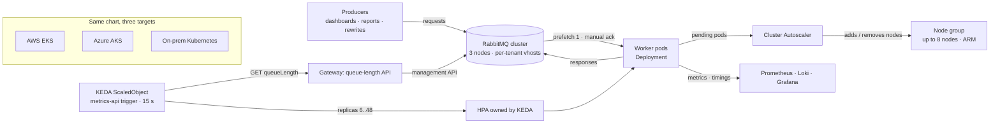

# Event-Driven Kubernetes Autoscaling

 -lightgrey) 

> **Architecture write-up.** This documents a system I designed and built as a DevOps Engineer at Faclon Labs (Mumbai). The implementation belongs to my employer and is not published; what follows is the design, the moving parts and the outcomes, with internal names and details left out.

The expression engine's on-demand workers run on Kubernetes, scaled by KEDA
on RabbitMQ queue depth with the Cluster Autoscaler adding nodes behind them.
Capacity follows the queue: **6 → 48 pods** at peak across **8 nodes**,
absorbing bursts of **10K–40K messages** — typically a customer rewriting
months of historical data — without anyone intervening. The queue depth
reaches KEDA through a small **queue-length API** on the platform's gateway
rather than a direct broker connection, so the same ScaledObject runs on
**EKS, on AKS and on-prem** without exposing RabbitMQ to the clusters. KEDA
polls it every **15 s**, scales up fast and down slowly.

## The problem

Message-driven workloads ran on fixed capacity. A burst meant a growing backlog
and a human adding workers; a quiet night meant paying for idle ones. Both
failure modes were manual, and a second cloud was coming.

## Architecture

## How it scales

1. Producers publish; the queue depth per virtual host is the single signal
   of demand.
2. The gateway exposes that depth as a tiny JSON endpoint (one number per
   queue) read from the broker's management API — the clusters never hold
   broker credentials.
3. KEDA's `metrics-api` trigger polls the endpoint every 15 s and sets the
   worker Deployment's replicas between a floor of 6 and a ceiling of 48,
   proportional to backlog per pod.
4. Scale-up is aggressive (up to 6 pods every 15 s); scale-down is slow (8
   pods a minute, behind a 30-minute stabilisation window) so a lull in the
   middle of a rewrite does not tear the pool down.
5. When pods cannot be scheduled, the Cluster Autoscaler adds nodes to the ARM
   node group; when they drain, it removes them.
6. Workers consume with prefetch 1 and acknowledge only after publishing the
   answer, so a pod removed mid-burst costs a redelivery, not a lost request.

## Design points

- **Scale on the queue, not on CPU.** CPU lags demand; queue depth *is* demand.
- **An API between KEDA and the broker** keeps credentials out of the
  clusters, makes the signal cloud-agnostic, and lets the same Helm chart
  carry the ScaledObject to AWS, Azure and on-prem with only values changed.
- **Asymmetric policies**: fast up for user-facing latency, slow down for
  bursty workloads that pause between waves.
- **A floor keeps latency flat** for normal traffic; a ceiling keeps a bad
  producer from scaling costs without bound.
- **Two layers of elasticity**: KEDA for pods (seconds), the Cluster
  Autoscaler for nodes (minutes).

## Outcomes

- **6 → 48 pods** at peak, across **8 nodes**.
- **10K–40K-message bursts** handled with no manual backlog intervention.
- One scaling definition across EKS, AKS and on-prem.
- Capacity matched to demand instead of provisioned for the worst case.

## Stack

Kubernetes (EKS, AKS, on-prem) · KEDA (metrics-api trigger) · Cluster Autoscaler · HPA · RabbitMQ · Helm · Prometheus / Grafana / Loki

## My role

Introduced Kubernetes for this workload, designed the scaling model, wrote the
queue-length API and the Helm chart that carries the ScaledObject, and operate
it in production on both clouds.
