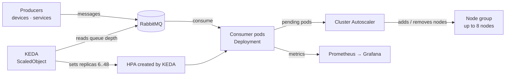

# Event-Driven Kubernetes Autoscaling

 -lightgrey) 

> **Architecture write-up.** This documents a system I designed and built as a DevOps Engineer at Faclon Labs (Mumbai). The implementation belongs to my employer and is not published; what follows is the design, the moving parts and the outcomes, with internal names and details left out.

Workload processing moved onto Kubernetes, with KEDA scaling the consumers on
RabbitMQ queue depth and the Cluster Autoscaler adding nodes behind them.
Capacity now follows the queue: **6 → 48 pods** at peak across **8 nodes**,
absorbing bursts of **10K–40K messages** without anyone intervening.

## The problem

Message-driven workloads ran on fixed capacity. A burst meant a growing backlog
and a human adding workers; a quiet night meant paying for idle ones. Both
failure modes were manual.

## Architecture

## How it scales

1. Producers publish; the queue depth is the single signal of demand.
2. A KEDA `ScaledObject` polls RabbitMQ and sets the consumer Deployment's
   replica count between a floor of 6 and a ceiling of 48, proportional to
   backlog per pod.
3. When pods cannot be scheduled, the Cluster Autoscaler adds nodes; when
   they drain, it removes them.
4. As the backlog clears, KEDA scales consumers back down to the floor.

## Design points

- **Scale on the queue, not on CPU.** CPU lags demand; queue depth *is* demand.
- **A floor keeps latency flat** for normal traffic; a ceiling keeps a bad
  producer from scaling costs without bound.
- **Consumers are stateless and idempotent**, so a pod removed mid-burst
  costs a redelivery, not a lost message.
- **Two layers of elasticity**: KEDA for pods (seconds), the Cluster
  Autoscaler for nodes (minutes).

## Outcomes

- **6 → 48 pods** at peak, across **8 nodes**.
- **10K–40K-message bursts** handled with no manual backlog intervention.
- Capacity matched to demand instead of provisioned for the worst case.

## Stack

Kubernetes (EKS) · KEDA · Cluster Autoscaler · HPA · RabbitMQ · Helm · Prometheus / Grafana

## My role

Introduced Kubernetes for this workload, designed the scaling model and
operated it in production.
